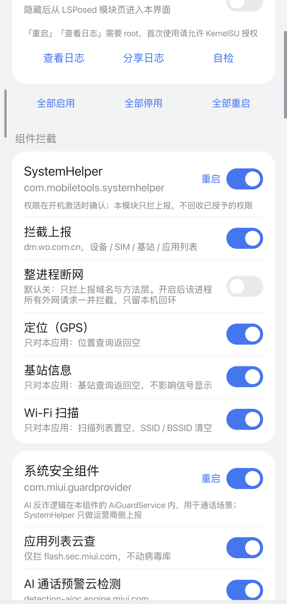
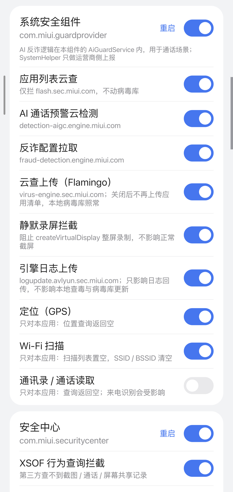

<div align="center">

# HyperPGuard


在采集入口、本地存储、对外接口、网络出口四层拦截 HyperOS 预装组件的隐私上报

</div>

预装系统组件会持续采集设备标识、应用使用记录、位置、通话行为等信息，并通过网络或跨进程接口提供给厂商、运营商或第三方。本模块在这些通道上按应用分组拦截，开关与 LSPosed 作用域联动。

> 仅供个人在自有设备上学习研究使用。使用前请阅读 [DISCLAIMER.txt](DISCLAIMER.txt)。

## 当前支持的版本

- Android 10 – Android 16 的 HyperOS
- LSPosed 2.2.x（libxposed API 100+）
- Root：KernelSU / Magisk / APatch（「重启」「查看记录」需要）

## 安装

1. 安装 `HyperPGuard`
2. 在 LSPosed 中启用「HyperPGuard」
3. 打开应用，首次会向 LSPosed 请求全部作用域，允许即可；也可在 LSPosed 里手动勾选
4. 在模块里对目标应用点一次「重启」，或点批量行的「全部重启」，让它重新加载

作用域外的应用不会被注入。

## 使用

**分组开关**：每张卡片右上角是该应用的开关，等同于它在 LSPosed 里的作用域开关。组关闭时组内子项置灰不可操作。

**子项开关**：可以只留某条规则，例如只要 XSOF 拦截就把域名层那项关掉。会影响系统功能的规则一律默认关闭，副标题写明代价。

**重启**：改完开关点「重启」执行 `am force-stop`，应用下次启动重新注入；批量行有「全部重启」。系统常驻组件被停止后通常几秒内会被系统拉起，等于自动完成重启。

**查看记录 / 分享日志**：读取本地 logcat 中本模块的输出，可导出分享。日志不包含电话号码、行为库内容或调用参数。

**抓取模式**：记录「访问了但没被规则命中」的域名，用于补规则，平时保持关闭。

**关于 / 检查更新**：卡片底部列出 GitHub 仓库、LSPosed 模块页与 Issues 入口，点「检查更新」会向 GitHub API 取最新 release tag 与当前版本比对；不点就不发任何请求。

## 拦截层次

| 层 | 做法 |
|---|---|
| 网络出口 | Hook `URL#openConnection`、`InetAddress#getByName`、`Socket` 构造与 `connect`，规则为「域名后缀 + 可选路径」 |
| 隐私 API | 应用列表、使用记录、设备标识、短信发送、XMSF 代发广播，在数据来源处截断 |
| 行为库 | 按 `screenshot` / `screen_share` / `call_forwarding` / `airplane_mode` / `fraud_phone` / `voip_record` / `fraud_url` / `install_app` 八张表名拦 `SQLiteDatabase` 写入 |
| 静默录屏 | `MediaProjection#createVirtualDisplay` 不建立 |
| 方法层 | 反射定位方法后直接返回：SystemHelper 发送与入队、analytics 使用记录聚合 |
| XSOF | Provider / AIDL / 写库 / 评分四层，第三方查不到截图、通话、屏幕共享记录 |

方法层与网络层互不依赖：类名变化时域名规则仍在工作，域名更换时方法层仍在工作，日志能分辨是哪一层命中。

## 覆盖组件

| 组件 | 包名 | 拦截内容 |
|---|---|---|
| SystemHelper | `com.mobiletools.systemhelper` | 运营商遥测；默认整进程断网（无用户功能）；定位 / 基站 / Wi-Fi 扫描默认关 |
| 系统安全组件 | `com.miui.guardprovider` | 应用列表云查、AI 通话预警云检测、反诈配置（AI 反诈逻辑 `AiGuardService` 在本组件内，用于通话场景）；静默录屏拦截默认开，Flamingo 云查上传默认关；定位 / Wi-Fi / 通讯录通话默认关 |
| 安全中心 | `com.miui.securitycenter` | XSOF 查询与写库、行为库写入、反诈配置、志愿者传感器上报；云查 / 鉴权 / 月报 / 防窥分类 / 地震报警定位 / ADB 验证 / 设备标识默认关；定位、通讯录 / 通话 / 短信默认关 |
| 小米统计 | `com.miui.analytics` | 整域 + DoH 旁路；默认整进程断网 |
| 应用安装器 | `com.miui.packageinstaller` | AVL 上报、活跃统计、安装页广告位 |
| 应用商店 | `com.xiaomi.market` | 广告配置下发 |
| 小米服务框架 | `com.xiaomi.xmsf` | 广告接口 |
| 运营商服务 | `com.xiaomi.registration` | 明文 CTEI 上报（默认拦）、设备注册（默认关）；定位 / 基站默认关 |
| 移动 DM | `com.miui.dmregservice` | `fxltsbl.com` 上报、App 清单、SIM 标识；基站 / Wi-Fi 扫描默认关 |
| 系统诊断 | `com.miui.misightservice` | 日志上传 `feedback.miui.com/misight/upload`、售后检测 `port.sec.miui.com/mqsas`、客服诊断 `chat.kefu.mi.com/openapi/misight/diagnostic`；触发条件是用户主动反馈或售后远程诊断，本地记录不等于已上传 |
| 小米可信服务 | `com.xiaomi.trustservice` | MRM 认证链、设备证书/密钥上报（均默认关） |
| 翻译组件 | `com.xiaomi.aiasst.vision` | 语音识别上传（`/speech/`），默认关 |

## 界面预览

| 总开关 / 批量操作 | 分组卡片 |
|---|---|
|  |  |

每组右上角就是该应用在 LSPosed 里的作用域开关；组关闭时组内子项置灰且不可点击。

## 日志说明

| 前缀 | 含义 |
|---|---|
| `attach <包名>` | 模块注入某进程成功 |
| `X(host)` | 域名规则命中 |
| `X(host+path)` | 域名 + 路径规则命中 |
| `X(strict)` | 整进程断网生效 |
| `? <tag> <host>` | 抓取模式记录：访问未被拦截 |
| `hook ok` / `hook miss` | 方法层安装成功 / 类名或签名不匹配 |
| `xsof provider hooked` | XSOF Provider 三个入口已拦截 |
| `xsof aidl hooked=N` | XSOF AIDL 接口拦截数量 |
| `xsof db write hooked=N` | XSOF 写库方法拦截数量 |
| `xsof score hooked=N` | 风险评分方法拦截数量 |
| `analytics scan scanned=N hooked=N` | analytics 签名扫描结果 |

## 如何确认生效

1. 启用模块，并对目标应用点一次「重启」
2. 触发一次它的上报行为（例如打开安全中心、安装一个应用）
3. 点「查看记录」，应看到 `attach <包名>` 与 `X(...)` 记录
4. XSOF 部分应全是 `hooked`，没有 `miss`
5. 只有 `attach` 没有 `X(...)` 时，开抓取模式跑一段时间，把 `?` 开头的域名补进规则

## 构建

需要 JDK 17 与 build-tools 35 及以上，SDK 路径用环境变量指定：

```sh
export ANDROID_JAR=/path/to/android.jar D8=/path/to/d8 AAPT2=/path/to/aapt2
export ZIPALIGN=/path/to/zipalign APKSIGNER=/path/to/apksigner
sh build.sh
```

## 源码结构

```
src/io/github/vivibibi30/hyperpguard/
├── HookEntry.java      入口与按包分发（XposedModule#onPackageReady）
├── Config.java         开关常量
├── NetGuard.java       网络出口：URL / InetAddress / Socket + 规则匹配
├── PrivacyApis.java    隐私 API：应用列表 / 使用记录 / 标识 / 短信 / XMSF 广播
├── CaptureHooks.java   行为库写入与静默录屏
├── XsofHooks.java      XSOF Provider / AIDL / 写库 / 评分 + MRM
├── AnalyticsHooks.java 统计方法层与签名扫描
├── Hooks.java          公共 hook 工具
├── Logs.java           统一日志标签
└── MainActivity.java   设置界面
```

```
res/values/           app_name 等字符串资源
assets/               免责声明
META-INF/xposed/      模块声明（必须打到 APK 根）
libs/libxposed-api.jar       libxposed API（compileOnly，不打进 dex）
libs/libxposed-service.jar   service + interface 合并版（必须打进 dex）
libs/api-82.jar              传统 Xposed API（编译兼容用）
docs/                 技术笔记、规则说明、截图
build.sh              一键构建
```

## 适配边界

- 域名名单可能漏项：地址可由配置下发；SystemHelper 与小米统计为整进程断网，其余组件依赖隐私 API 层与方法层
- 方法层类名随组件版本变化，日志里 `hook miss` 属正常，网络层与隐私 API 层不受影响
- 使用 native 网络栈（Cronet 等）的请求不受 Java 层 hook 影响
- `IMrm` 属 HAL 层，仅从 `ServiceManager` 侧断开
- `com.xiaomi.xmsf` 代发属于跨进程交接，只拦 analytics 自身 UID 覆盖不到
- 拦截范围限于已识别的通道，不代表覆盖 HyperOS 全部联网行为
- `com.mobiletools.systemhelper` 的权限在新机激活（OOBE）阶段授予，激活时的权限弹窗值得逐项看清；本模块只拦上报，不回收已授予的权限。对授权有疑虑时，可在设置里找「隐私与安全 / 反馈 / 用户体验计划」这类入口，或备份后重置手机重走开机引导
- 识别结论以静态分析与真机行为对照为准，单看一段静态代码不足以定性
- AI 反诈逻辑位于 `com.miui.guardprovider` 的 `AiGuardService`，用于通话场景；`com.mobiletools.systemhelper` 承担运营商侧的数据上报，两者不是同一条链路

## 常见问题

- **某个应用开关打不开**：该包可能不存在、被冻结或与系统共享 UID，LSPosed 无法把它加入作用域
- **日志为空**：`logcat` 环形缓冲已覆盖，或目标应用还没重启过
- **功能异常**：对应的默认关闭子项被打开了，按需关掉即可
- **方法层出现 `hook miss`**：组件版本变化，网络层与隐私 API 层不受影响

## 更新日志

### 1.3.5

- 「查看记录」改为「查看日志」，弹窗标题相应改为「模块日志」，不再叫「拦截记录」
- 没有记录时说明这里只列模块运行日志与被拦截的访问，没有拦截就是空的
- 「抓取模式」改名为「记录未拦截访问」，副标题写明用途

### 1.3.4

- 某一步安装失败不再中断整条 dispatch：网络、隐私 API、XSOF、行为库、录屏各自独立兜底
- 系统 Context 读开关被 AMS 拒绝时，改用目标包自己的 Context 再读一次（SystemHelper 这类进程此前只能拿到默认值）
- LSPosed 服务断开后自动重连，覆盖安装模块不必重开界面
- 自检新增总开关状态，「已注入进程」改读 LSPosed 的 modules 日志，attach 无记录时区分缓冲滚出与未注入

### 1.3.3

- 系统诊断卡片的说明改为适用于任意设备：只写触发来源，不写单台设备的记录状态

### 1.3.2

- 新增 `com.miui.misightservice` 覆盖：日志上传、售后检测、客服诊断三条规则，默认开
- 触发条件是用户主动反馈或售后远程诊断；本地数据库里的记录不等于已经上传


### 1.3.1

- SystemHelper 卡片补一行：权限在开机激活阶段确认，本模块只拦上报，不回收已授予的权限
- 系统安全组件卡片补一行：AI 反诈逻辑在 `AiGuardService` 内、用于通话场景，与 SystemHelper 不是同一条链路

更早版本见 [docs/CHANGELOG.md](docs/CHANGELOG.md) 或 Releases 页。

## 参考来源

以下项目的公开资料提供了识别目标与验证思路。本项目代码独立编写，未复制、未反编译复用其实现。

- **[HyperCeiler](https://github.com/ReChronoRain/HyperCeiler)**（GPL-3.0，作者 [Sevtinge](https://github.com/Sevtinge)，现维护于 [ReChronoRain](https://github.com/ReChronoRain)）— analytics 目标方法、`flash.sec.miui.com/detect/app`、安装器 `/avl/upload`、MRM 拦截思路
- **[XSOF Privacy](https://github.com/yunyizea/xsof-privacy)**（作者 yunyizea）— 8 类行为记录的拦截范围、`(null, 1017)` 拒绝语义、按组组织 hook
- **Hyper 隐私卫士**（`io.github.hyperprivacyguard`）— SystemHelper 采集入口特征、guardprovider 应用列表采集
- **[HyperOS4-XSOF-Analysis](https://github.com/FAQQAQ/HyperOS4-XSOF-Analysis)**（作者 [FAQQAQ](https://github.com/FAQQAQ)）— 7 个组件的静态逆向记录：整域范围、`om.tracking.miui.com/track/mt`、区域与备份域、DoH 重试、`framework.sec.miui.com`、`virus-engine.sec.miui.com`、地震/报警/EPS 族、`typdm.tydevice.com` 明文上报、analytics 6.33.0 的 `a.b.a.*` 结构
- **[OSAKOo](https://www.coolapk.com/feed/74882729?s=MzNlYzk4NWUxNWZhMjRnNmFlZTFjMDJ6a1664)**（酷安）— `fraud_detection_data.db` 八张表与 `screenshort_time` 拼写、`createScreenCaptureIntent` 零调用与 `privateLookupIn` 绕过、`clip.mp4` 上报链路、SystemHelper 采集项与明文上报、六个域名的实际用途
- **[Android OS Privacy Under the Loupe – A Tale from the East](https://ar5iv.labs.arxiv.org/html/2302.01890)**（ACM WiSec '23）— 四类敏感数据的分类，以及设备标识、位置、通讯录在预装组件里的采集面
- **酷安 [RooyCo《真问题还在》](https://www.coolapk.com/feed/74911090)** — `com.miui.dmregservice` 的存在与采集字段（Wi-Fi 列表、蓝牙、BSSID、路由器 MAC）、`operator_service_improve_plan`、采集频率
- **[frauddb](https://github.com/acnekot/frauddb)**（acnekot，MIT）— `fraud_detection_data.db` 八张表结构与库路径、`tel_number_md5` 算法
- **[misight-viewer](https://github.com/Artriai/misight-viewer)**（作者 [Artriai](https://github.com/Artriai)）— MiSight 数据库字段与事件分类、设备诊断与用户行为记录的区分依据
- **libxposed API**（Apache-2.0）、**LSPosed** — 模块入口与作用域接口

第三方组件：`Xposed API 82`、`libxposed API 102`（均为 Apache-2.0，编译期依赖）。

感谢以上作者与维护者。

## 免责声明

- 本模块仅用于在**本人拥有完全控制权**的 Android 设备上限制预装组件的上报行为，不提供任何入侵、破解他人系统或获取他人数据的能力
- 不做商业销售、付费分发，不得移除声明后再次分发
- 模块默认不联网、不收集、不上传任何信息；仅在手动点设置页「检查更新」时向 GitHub API 查询一次版本号，不发送任何设备标识或使用数据；开关配置存在本地，日志只在本地 logcat 读取
- 模块名称、包名、图标归作者所有，不得冒充官方版本
- 与小米、中国联通等厂商无隶属或合作关系，商标归各自权利人
- 按「现状」提供，不提供任何明示或暗示担保

完整九条条款见 [DISCLAIMER.txt](DISCLAIMER.txt)。

## 许可

GPL-3.0，见 [LICENSE](LICENSE)。

## English

HyperPGuard is an LSPosed module for HyperOS that blocks telemetry from preinstalled system components — carrier telemetry, cloud app scanning, installer stats, ads, XSOF behaviour queries and silent screen recording — at four stages: data source, local storage, IPC interfaces and network egress. Per-app switches, feature-affecting rules default off. Requires Android 10+, LSPosed 2.2.x and root for restart/log features.

Personal use only. See [DISCLAIMER.txt](DISCLAIMER.txt). GPL-3.0.
